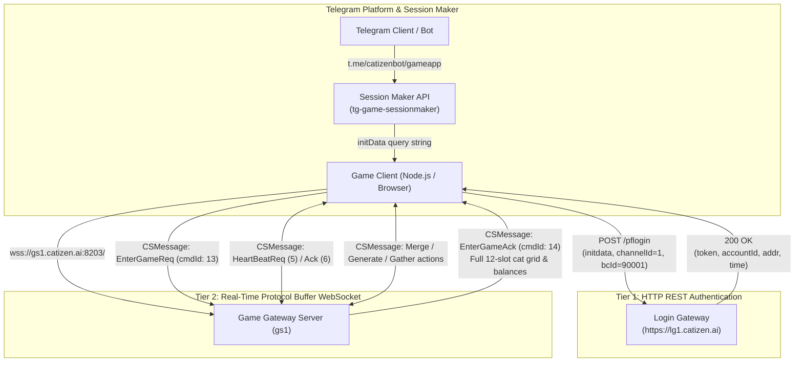
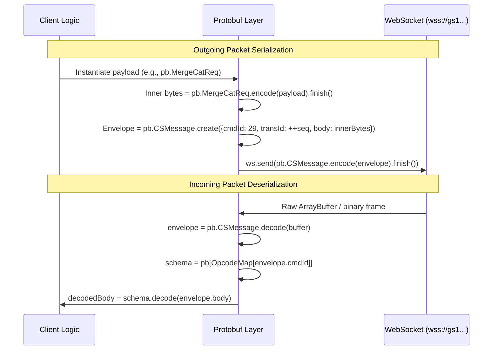

# Catizen Client-Server Communication Protocol Specification

This document provides a comprehensive, deep technical reference for the network communication architecture used by **Catizen** (Telegram Mini App game powered by the LayaAir engine). It covers session generation, HTTP authentication, the binary Protocol Buffer framing over WebSocket, the complete command opcode registry, and message payload schemas.

---

## 1. System Architecture Overview

Catizen utilizes a **hybrid two-tier client-server architecture**:



### Component Roles:
1. **Telegram WebApp Session**: Produces cryptographically signed `initData` (`user`, `auth_date`, `hash`, `signature`).
2. **Login Gateway (`https://lg1.catizen.ai/pflogin`)**: Authenticates Telegram credentials and provides user IDs, session `token`, and the active WebSocket gateway URL (`addr`).
3. **Real-Time Game Gateway (`wss://gs1.catizen.ai:8203/`)**: A persistent WebSocket connection exchanging binary Protocol Buffer messages for all active gameplay actions (merging cats, generating cats, idle gold claims, minigames, staking).

---

## 2. Binary Framing & Serialization Protocol

Catizen does **not** exchange JSON over WebSockets. All communication uses Google Protocol Buffers (`protobuf.js`) wrapped in a uniform binary envelope.

### 2.1 The Universal Envelope: `CSMessage`

Every packet sent to or received from the game server is encapsulated within `pb.CSMessage`:

```protobuf
syntax = "proto3";
package pb;

message CSMessage {
  int32 cmdId   = 1; // Numerical command identifier (maps to action enum)
  int32 transId = 2; // Incremental sequence / transaction ID
  bytes body    = 3; // Serialized binary payload of the inner protobuf message
}
```

### 2.2 Wire Protocol Flow



1. **Client-to-Server (`sendPacket`)**:
   - The inner message (e.g. `EnterGameReq`) is instantiated and serialized into binary bytes via `pb[cmdName].encode(payload).finish()`.
   - A `CSMessage` envelope is created with the numeric `cmdId`, incremented `transId`, and the inner `body` bytes.
   - The envelope is serialized and sent over WebSocket as an `ArrayBuffer`.
2. **Server-to-Client (`onMessage`)**:
   - The raw byte buffer is decoded into `CSMessage`.
   - The `cmdId` is resolved through the opcode dictionary (`clean_opcodes.json`).
   - The matching schema (`pb[cmdName]`) deserializes `envelope.body` into a JavaScript object.

---

## 3. Session Lifecycle & Handshake Walkthrough

### Phase 1: Obtaining Telegram WebApp `initData`
The client requests an authenticated session parameter string from the sessionmaker service:
* **Endpoint:** `POST https://tg-game-sessionmaker.onrender.com/api/get-init-data`
* **Payload:**
  ```json
  {
    "bot": "catizenbot",
    "short_name": "gameapp"
  }
  ```
* **Returns:**
  ```json
  {
    "success": true,
    "initData": "user=%7B%22id%22%3A7749030503...%7D&chat_instance=...&auth_date=1794037475&hash=..."
  }
  ```

### Phase 2: HTTP Login (`/pflogin`)
The client exchanges `initData` for game credentials:
* **Endpoint:** `POST https://lg1.catizen.ai/pflogin`
* **Payload:**
  ```json
  {
    "channelId": 1,
    "bcId": 90001,
    "data": {
      "initdata": "<RAW_INITDATA_STRING>",
      "botname": "catizenbot",
      "inviter": 0,
      "token": ""
    },
    "language": "en"
  }
  ```
* **Key Response Fields:**
  ```json
  {
    "accountId": 50722603,
    "userId": 51679031,
    "name": "C1_7749030503",
    "token": "34f6f9752797c52f98bcfe6911446dd0",
    "addr": "wss://gs1.catizen.ai:8203",
    "time": 1794037475,
    "nickName": "Saqlain"
  }
  ```

### Phase 3: WebSocket Connection & Handshake (`EnterGameReq`)
Immediately upon WebSocket connection open (`onopen`), the client must send `EnterGameReq` (Opcode `13`):
* **Request:** `pb.EnterGameReq`
  ```json
  {
    "accountId": 50722603,
    "userId": 51679031,
    "name": "C1_7749030503",
    "token": "34f6f9752797c52f98bcfe6911446dd0",
    "time": 1794037475,
    "bcId": 90001,
    "sex": 0,
    "nickName": "Saqlain",
    "newNickName": "",
    "inviterId": 0,
    "inviterClubId": 0,
    "relogin": 0,
    "inviteCode": "",
    "startParam": ""
  }
  ```
* **Response (`EnterGameAck`, Opcode `14`):**
  Returns complete game state, balances, and the player's 12-slot cat grid:
  ```json
  {
    "serverId": 3,
    "code": 0,
    "userInfo": {
      "cats": [5, 9, 12, 5, 5, 4, 6, 5, 5, 5, 6, 5],
      "gold": "9084469",
      "rankGold": "37264260",
      "fishCoin": "50",
      "exData": {
        "maxCatLvl": 12,
        "freeCatLvl": 1,
        "maxGoldSpeedLvl": 1
      }
    }
  }
  ```

### Phase 4: Heartbeat Loop
To prevent disconnect by timeout (server drops idle connections after ~9 seconds), the client sends:
* **Packet:** `HeartBeatReq` (Opcode `5`) every 5 seconds.
* **Server Reply:** `HeartBeatAck` (Opcode `6`).

---

## 4. Key Gameplay Message Schemas

### 4.1 Cat Board & Grid Management

#### The 12-Slot Board Structure
The board grid is stored as a fixed 12-element array of integer levels (`userInfo.cats`):
* Length is always `12` (representing positions 0 to 11).
* Values represent the cat's level (e.g., `5` = Level 5 cat; empty slots are `0` or `null`).

#### Merging Cats (`MergeCatReq` / `MergeCatAck`)
* **Request (cmdId: 29):**
  ```protobuf
  message MergeCatReq {
    repeated int32 indexs = 1; // Grid slot indices to merge, e.g. [0, 3]
  }
  ```
* **Response (cmdId: 30):**
  ```protobuf
  message MergeCatAck {
    int32 code = 1;             // 0 = Success
    repeated int32 cats = 2;    // Full updated 12-slot grid
    ItemInfo items = 3;         // Currency delta (points / rewards)
    RandomEventData randomEvent = 4;
  }
  ```

#### Spawning / Purchasing Cats (`GenerateCatReq` / `GenerateCatAck`)
* **Request (cmdId: 27):**
  ```protobuf
  message GenerateCatReq {
    int32 type = 1; // 1 = Buy with gold, 2 = Free timer cat, 3 = Fish cat
  }
  ```
* **Response (cmdId: 28):**
  ```protobuf
  message GenerateCatAck {
    int32 code = 1;
    repeated int32 cats = 2;
    string gold = 3; // Updated gold balance
  }
  ```

#### Deleting / Selling Cats (`DelCatReq` / `DelCatAck`)
* **Request (cmdId: 33):**
  ```protobuf
  message DelCatReq {
    int32 index = 1; // Slot index to discard (0-11)
  }
  ```

#### Switching Cat Positions (`SwitchPosCatReq` / `SwitchPosCatAck`)
* **Request (cmdId: 35):**
  ```protobuf
  message SwitchPosCatReq {
    int32 fromIndex = 1;
    int32 toIndex = 2;
  }
  ```

### 4.2 Economy, Gold & Offline Progression

#### Gathering / Syncing Gold (`GatherGoldReq` / `GatherGoldAck`)
* **Request (cmdId: 31):**
  ```protobuf
  message GatherGoldReq {
    int64 time = 1; // Client timestamp
  }
  ```
* **Response (cmdId: 32):**
  ```protobuf
  message GatherGoldAck {
    int32 code = 1;
    string gold = 2;
    string rankGold = 3;
  }
  ```

#### Speed Boost / Multiplier (`BoostGoldReq` / `BoostGoldAck`)
* **Request (cmdId: 37):** Used to activate 2x speed multipliers (via free timer or TON transaction).

#### Offline Earnings Claim (`GetOffLineGoldReq` / `GetOffLineGoldAck`)
* **Request (cmdId: 39):** Claims accumulated idle gold generated while disconnected.

---

## 5. Complete Opcode & Command Registry

The Catizen client registers **232 commands** in its protocol dispatch table (`clean_opcodes.json`). Below is the complete categorised reference:

### 5.1 System, Connection & Session (Opcodes 1–20)
| Opcode | Command Name | Type | Description |
| :---: | :--- | :--- | :--- |
| `1` | `ErrorAck` | Response | Universal error notification from server |
| `4` | `ServerStateNtf` | Push Ntf | Server maintenance / state notification |
| `5` | `HeartBeatReq` | Request | Keepalive ping packet (every 5 seconds) |
| `6` | `HeartBeatAck` | Response | Keepalive pong response |
| `11` | `CreateRoleReq` | Request | Initial character creation (new account) |
| `12` | `CreateRoleAck` | Response | Character creation confirmation |
| `13` | `EnterGameReq` | Request | Core login handshake payload |
| `14` | `EnterGameAck` | Response | Core login acknowledgment containing `UserInfo` & grid |
| `15` | `CommandReq` | Request | Administrative / GM debug command request |
| `16` | `CommandAck` | Response | Administrative command response |
| `18` | `UserInfoNtf` | Push Ntf | Push update of complete player user profile |
| `19` | `AccountInfoChangeNtf`| Push Ntf | User basic profile field updates |
| `20` | `MessageEventNtf` | Push Ntf | Server broadcast or popup event message |

### 5.2 Cat Grid & Inventory Management (Opcodes 26–56)
| Opcode | Command Name | Type | Description |
| :---: | :--- | :--- | :--- |
| `26` | `ItemChangeNtf` | Push Ntf | Inventory or currency balance changes |
| `27` | `GenerateCatReq` | Request | Purchase / spawn a new cat |
| `28` | `GenerateCatAck` | Response | Returns new cat index and remaining balance |
| `29` | `MergeCatReq` | Request | Merge two cats on specified grid indices |
| `30` | `MergeCatAck` | Response | Returns upgraded cat and refreshed board |
| `31` | `GatherGoldReq` | Request | Synchronize collected idle gold |
| `32` | `GatherGoldAck` | Response | Gold balance confirmation |
| `33` | `DelCatReq` | Request | Discard / trash a cat from the board |
| `34` | `DelCatAck` | Response | Board update after cat removal |
| `35` | `SwitchPosCatReq`| Request | Swap positions of two cats on grid |
| `36` | `SwitchPosCatAck`| Response | Swap confirmation |
| `37` | `BoostGoldReq` | Request | Activate gold generation speed boost |
| `38` | `BoostGoldAck` | Response | Boost confirmation and expiration timestamp |
| `39` | `GetOffLineGoldReq`| Request | Collect idle gold accumulated offline |
| `40` | `GetOffLineGoldAck`| Response | Offline gold reward confirmation |
| `41` | `GetAirDropCatReq`| Request | Claim airdrop cat gift box |
| `42` | `GetAirDropCatAck`| Response | Spawns airdrop cat on available slot |
| `44` | `BoostGoldNtf` | Push Ntf | Speed boost duration / expiry broadcast |
| `46` | `TokensInfoChangeNtf`| Push Ntf | Web3 / token balance updates (CATI, wCATI) |
| `47` | `GetFreeCatReq` | Request | Claim time-based free delivery cat |
| `48` | `GetFreeCatAck` | Response | Spawns free cat |
| `49` | `RandomEventReq`| Request | Trigger dog/duck floating visitor event |
| `50` | `RandomEventAck`| Response | Returns event reward details |
| `51` | `GetRandomEventAwardReq` | Request | Claim reward from visitor event |
| `52` | `GetRandomEventAwardAck` | Response | Confirmation of awarded currencies |
| `53` | `GetRandomEventBoxReq` | Request | Open visitor event chest |
| `54` | `GetRandomEventBoxAck` | Response | Chest contents |
| `55` | `MergeCatAutoReq`| Request | Request auto-merge bot pass cycle |
| `56` | `MergeCatAutoAck`| Response | Auto-merge batch results |
| `58` | `RandomEventChangeNtf` | Push Ntf | Live visitor status changes |
| `59` | `OffLineGoldNtf`| Push Ntf | Offline calculation updates |
| `60` | `CountsChangeNtf`| Push Ntf | Counter / quota changes (daily limits) |
| `61` | `GetFreeBoxNumReq`| Request | Query remaining free boxes today |
| `62` | `GetFreeBoxNumAck`| Response | Free box quota response |

### 5.3 Leaderboards, Social & Ranking (Opcodes 63–128)
| Opcode | Command Name | Type | Description |
| :---: | :--- | :--- | :--- |
| `63` | `RandomEventRankRushReq` | Request | Enter event leaderboard rush |
| `64` | `RandomEventRankRushAck` | Response | Rank rush standing |
| `65` | `GetRandomEventRankRushAwardReq` | Request | Claim event rush leaderboard prizes |
| `66` | `GetRandomEventRankRushAwardAck` | Response | Claim confirmation |
| `67` | `GetReportReq` | Request | Retrieve daily/weekly account stats report |
| `68` | `GetReportAck` | Response | Report data payload |
| `69` | `OpenLimitTimeGoodsReq` | Request | Open flash sale / limited-time shop items |
| `70` | `OpenLimitTimeGoodsAck` | Response | Limited offer details |
| `71` | `StrayCatGoodsHistoryReq`| Request | Stray cat shop purchase history |
| `72` | `StrayCatGoodsHistoryAck`| Response | Purchase history list |
| `73` | `GetRechargeRecordReq` | Request | In-app purchase history |
| `74` | `GetRechargeRecordAck` | Response | Recharge history list |
| `75` | `ReportStarPayStatusReq` | Request | Telegram Stars payment verification |
| `98` | `SyncRechargeNtf` | Push Ntf | Push receipt of processed payment |
| `99` | `ReceiveRechargeReq` | Request | Claim purchased goods |
| `100` | `ReceiveRechargeAck` | Response | Receipt acknowledgement |
| `103` | `JoinClubReq` | Request | Join a player guild / club |
| `104` | `JoinClubAck` | Response | Guild join status |
| `105` | `GetRecruitClubListReq` | Request | Browse clubs accepting members |
| `106` | `GetRecruitClubListAck` | Response | List of public clubs |
| `107` | `QuitClubReq` | Request | Leave current guild |
| `108` | `QuitClubAck` | Response | Guild leave confirmation |
| `109` | `ClubMemberRankReq` | Request | Guild member contribution leaderboard |
| `110` | `ClubMemberRankAck` | Response | Member contribution ranking list |
| `111` | `GetStatsReq` | Request | Query player macro statistics |
| `112` | `GetStatsAck` | Response | Statistics response |
| `113` | `GetGoldRankListReq` | Request | Global gold leaderboard query |
| `114` | `GetGoldRankListAck` | Response | Global top players by gold |
| `115` | `ClubInfoReq` | Request | Query details of player's club |
| `116` | `ClubInfoAck` | Response | Club profile, level, member list |
| `117` | `FrensInfoReq` | Request | Referral friends summary query |
| `118` | `FrensInfoAck` | Response | Referred users list and earned commissions |
| `119` | `InviteRankListReq` | Request | Top referral inviters leaderboard |
| `120` | `InviteRankListAck` | Response | Top inviters list |
| `121` | `GetClubGoldRankListReq`| Request | Club guild global rankings |
| `122` | `GetClubGoldRankListAck`| Response | Guild ranking list |
| `123` | `GetMyRankReq` | Request | Query current user's individual rank |
| `124` | `GetMyRankAck` | Response | User rank position and score |
| `126` | `GoldChangeNtf` | Push Ntf | Server gold change notification |
| `127` | `FrensInviterDoubleInfoReq`| Request | Referral bonus multiplier info |
| `128` | `FrensInviterDoubleInfoAck`| Response | Multiplier details |

### 5.4 Clubs & Web3 Wallet Binding (Opcodes 157–204)
| Opcode | Command Name | Type | Description |
| :---: | :--- | :--- | :--- |
| `157` | `CreateClubReq` | Request | Create a new player club/guild |
| `158` | `CreateClubAck` | Response | Club creation confirmation |
| `159` | `ClubGroupUserNameReq` | Request | Link Telegram group/channel to club |
| `160` | `ClubGroupUserNameAck` | Response | Link confirmation |
| `188` | `ClubInfoNtf` | Push Ntf | Club status / member activity broadcast |
| `201` | `GetWalletAddrReq` | Request | Query connected TON / Mantle wallet |
| `202` | `GetWalletAddrAck` | Response | Bound wallet address string |
| `203` | `BindWalletReq` | Request | Bind a Web3 wallet address to account |
| `204` | `BindWalletAck` | Response | Binding status |

### 5.5 Fishing Minigame (Opcodes 251–276)
| Opcode | Command Name | Type | Description |
| :---: | :--- | :--- | :--- |
| `251` | `FishingReq` | Request | Cast fishing line (spend Fish Coins) |
| `252` | `FishingAck` | Response | Fishing catch result (points, tokens, speed) |
| `253` | `MyFishInfoReq` | Request | Query player fishing level & rod stats |
| `254` | `MyFishInfoAck` | Response | Fishing profile payload |
| `255` | `FishRankListReq` | Request | Fishing leaderboard |
| `256` | `FishRankListAck` | Response | Top fishers list |
| `257` | `FishInfoReq` | Request | Fishing pool prize pool status |
| `258` | `FishInfoAck` | Response | Available prize pool data |
| `263` | `FishRewardPoolReq` | Request | Query fish reward distribution pool |
| `264` | `FishRewardPoolAck` | Response | Reward pool distribution |
| `265` | `GetFishRankRewardReq` | Request | Claim fishing tournament prizes |
| `266` | `GetFishRankRewardAck` | Response | Prize claim confirmation |
| `267` | `FishHistoryReq` | Request | Fishing catch log history |
| `268` | `FishHistoryAck` | Response | Catch logs |
| `269` | `FishRodUpReq` | Request | Upgrade fishing rod level |
| `270` | `FishRodUpAck` | Response | Upgraded rod stats |
| `275` | `PayClubBoosterReq` | Request | Spend fish coins on club booster |
| `276` | `PayClubBoosterAck` | Response | Booster status |

### 5.6 Lucky Spin / Wheel & Social Assist (Opcodes 281–312)
| Opcode | Command Name | Type | Description |
| :---: | :--- | :--- | :--- |
| `281` | `TurnReq` | Request | Spin the roulette lucky wheel |
| `282` | `TurnAck` | Response | Spin reward result |
| `283` | `TurnInfoReq` | Request | Query available wheel spins and timers |
| `284` | `TurnInfoAck` | Response | Spin tickets and configuration |
| `285` | `TurnRecordReq` | Request | Wheel winning history |
| `286` | `TurnRecordAck` | Response | Winning history list |
| `287` | `TurnWithdrawReq` | Request | Withdraw token rewards won from wheel |
| `288` | `TurnWithdrawAck` | Response | Withdrawal confirmation |
| `289` | `TurnWithdrawRecordReq`| Request | Wheel withdrawal transaction logs |
| `290` | `TurnWithdrawRecordAck`| Response | Withdrawal transaction list |
| `291` | `TurnWithdrawHistoryReq`| Request | Historical wheel earnings |
| `292` | `TurnWithdrawHistoryAck`| Response | Earnings history |
| `293` | `ClaimTurnCountReq` | Request | Claim free daily spin vouchers |
| `294` | `ClaimTurnCountAck` | Response | New spin count |
| `295` | `HelpTurnRecordReq` | Request | Referral spin assist logs |
| `296` | `HelpTurnRecordAck` | Response | Assist logs |
| `297` | `OtherHelpTurnNtf` | Push Ntf | Notification when a friend boosts your wheel |
| `298` | `GetOffHelpTurnRecordReq`| Request | Query assists received while offline |
| `299` | `GetOffHelpTurnRecordAck`| Response | Offline assist count |
| `300` | `StartTurnReq` | Request | Initiate friend-assisted wheel run |
| `301` | `StartTurnAck` | Response | Initiated turn details |
| `305` | `PreHelpOtherTurnReq` | Request | Prepare to assist another user's wheel |
| `306` | `PreHelpOtherTurnAck` | Response | Assistance validation |
| `307` | `HelpOtherTurnReq` | Request | Execute assist for friend |
| `308` | `HelpOtherTurnAck` | Response | Assist result |
| `311` | `HskSpinReq` | Request | HashKey ecosystem promotional wheel spin |
| `312` | `HskSpinAck` | Response | HashKey spin prize result |

### 5.7 On-Chain Staking & Launchpool (Opcodes 331–386)
| Opcode | Command Name | Type | Description |
| :---: | :--- | :--- | :--- |
| `331` | `GetLaunchListReq` | Request | Query active Launchpool projects |
| `332` | `GetLaunchListAck` | Response | List of available token staking pools |
| `333` | `LaunchStakeReq` | Request | Stake CATI / cats into Launchpool |
| `334` | `LaunchStakeAck` | Response | Staking confirmation |
| `335` | `ReceiveLaunchProfitReq`| Request | Harvest Launchpool token yield |
| `336` | `ReceiveLaunchProfitAck`| Response | Harvest confirmation |
| `338` | `LaunchPoolBonusNtf` | Push Ntf | Push notification of earned yield bonus |
| `341` | `GetStakeListReq` | Request | Query staking asset pools |
| `342` | `GetStakeListAck` | Response | Available staking pools list |
| `343` | `StakeReq` | Request | Deposit cat / tokens into vault |
| `344` | `StakeAck` | Response | Vault deposit confirmation |
| `345` | `StakeRetrieveReq` | Request | Unstake / withdraw principal from vault |
| `346` | `StakeRetrieveAck` | Response | Unstake confirmation |
| `347` | `StakeEarnValClaimReq` | Request | Claim accrued vault interest |
| `348` | `StakeEarnValClaimAck` | Response | Claim interest confirmation |
| `349` | `GetStakeReq` | Request | Query current active stake position |
| `350` | `GetStakeAck` | Response | Staked position amount and APY |
| `351` | `RetrieveStakeReq` | Request | Emergency stake withdrawal |
| `352` | `RetrieveStakeAck` | Response | Emergency withdrawal result |
| `385` | `GetDexApyReq` | Request | Query DEX liquidity pool APY stats |
| `386` | `GetDexApyAck` | Response | Current DEX APY rates |

### 5.8 Payments, Deposits & Withdrawals (Opcodes 401–484)
| Opcode | Command Name | Type | Description |
| :---: | :--- | :--- | :--- |
| `401` | `TokenInfoListReq` | Request | Query on-chain token balances and pricing |
| `402` | `TokenInfoListAck` | Response | Token balances list |
| `403` | `TokenRecordReq` | Request | Token transaction history |
| `404` | `TokenRecordAck` | Response | Token transaction list |
| `405` | `TokenRecordDetailReq` | Request | Specific transaction hash details |
| `406` | `TokenRecordDetailAck` | Response | Detail payload |
| `411` | `WithdrawTokenReq` | Request | Request on-chain token withdrawal |
| `412` | `WithdrawTokenAck` | Response | Withdrawal request status |
| `413` | `WithdrawRecordReq` | Request | On-chain withdrawal records |
| `414` | `WithdrawRecordAck` | Response | Withdrawal record list |
| `415` | `WithdrawAirdropTokenReq`| Request | Claim and withdraw airdrop tokens |
| `416` | `WithdrawAirdropTokenAck`| Response | Airdrop withdrawal status |
| `421` | `CheckWalletReq` | Request | Verify wallet address signature |
| `422` | `CheckWalletAck` | Response | Verification result |
| `423` | `WalletHistoryReq` | Request | Wallet interaction history |
| `424` | `WalletHistoryAck` | Response | History list |
| `425` | `SaveClaimReq` | Request | Commit airdrop claim distribution |
| `426` | `SaveClaimAck` | Response | Commit status |
| `427` | `CancelClaimReq` | Request | Cancel pending claim request |
| `428` | `CancelClaimAck` | Response | Cancellation confirmation |
| `429` | `SaveExchangeClaimReq` | Request | Exchange tokens for on-chain assets |
| `430` | `SaveExchangeClaimAck` | Response | Exchange status |
| `441` | `TonExchangeRateReq` | Request | Query live TON / USD price quote |
| `442` | `TonExchangeRateAck` | Response | Current rate |
| `451` | `RequestDepositReq` | Request | Generate TON deposit payload address |
| `452` | `RequestDepositAck` | Response | Deposit address and comment memo |
| `453` | `ReceiveDepositReq` | Request | Confirm completed deposit transaction |
| `454` | `ReceiveDepositAck` | Response | Deposit credited confirmation |
| `455` | `SyncDepositNtf` | Push Ntf | Push notification when deposit confirms |
| `461` | `RequestPayReq` | Request | Initiate TON Connect payment transaction |
| `462` | `RequestPayAck` | Response | Payment transaction parameters |
| `463` | `CheckPayReq` | Request | Verify status of submitted payment |
| `464` | `CheckPayAck` | Response | Payment status (Success/Pending/Failed) |
| `465` | `RequestPrePayReq` | Request | Prepare pre-order payment payload |
| `466` | `RequestPrePayAck` | Response | Pre-order metadata |
| `467` | `SetPayTimeReq` | Request | Synchronize payment window timer |
| `468` | `SetPayTimeAck` | Response | Timer acknowledgement |
| `469` | `RequestPayTimeReq` | Request | Query remaining payment window |
| `470` | `RequestPayTimeAck` | Response | Remaining seconds |
| `481` | `BCCheckInReq` | Request | Daily blockchain check-in transaction |
| `482` | `BCCheckInAck` | Response | Check-in reward status |
| `483` | `BCCheckInDataReq` | Request | Query consecutive check-in streak |
| `484` | `BCCheckInDataAck` | Response | Streak count and upcoming rewards |

### 5.9 Governance, Partner Integrations & Push (Opcodes 501–572)
| Opcode | Command Name | Type | Description |
| :---: | :--- | :--- | :--- |
| `501` | `GetVotingInfoReq` | Request | Query community governance proposals |
| `502` | `GetVotingInfoAck` | Response | Proposal list and vote tallies |
| `503` | `VotingReq` | Request | Cast voting tokens on a proposal |
| `504` | `VotingAck` | Response | Vote registration result |
| `511` | `CheckBitgetReq` | Request | Check Bitget partner wallet bonus |
| `512` | `CheckBitgetAck` | Response | Bitget eligibility |
| `521` | `CheckHskReq` | Request | Check HashKey eligibility |
| `522` | `CheckHskAck` | Response | HashKey status |
| `523` | `CheckHskQualifyReq` | Request | Query HashKey whitelist qualification |
| `524` | `CheckHskQualifyAck` | Response | Whitelist status |
| `531` | `SetMexcInfoReq` | Request | Bind MEXC exchange account UID |
| `532` | `SetMexcInfoAck` | Response | MEXC binding status |
| `541` | `CheckCatiReq` | Request | Check CATI token airdrop qualification |
| `542` | `CheckCatiAck` | Response | Qualification parameters |
| `551` | `WatchMsgReq` | Request | Subscribe to real-time chat/notification stream |
| `552` | `WatchMsgAck` | Response | Subscription active |
| `553` | `UnWatchMsgReq` | Request | Unsubscribe from notification stream |
| `554` | `UnWatchMsgAck` | Response | Unsubscribed |
| `561` | `ReportClientReq` | Request | Telemetry / client crash reporting |
| `562` | `ReportClientAck` | Response | Telemetry acknowledgement |
| `563` | `ShareReq` | Request | Track social share link event |
| `564` | `ShareAck` | Response | Share bonus credited |
| `571` | `SysMsgNtf` | Push Ntf | Server-wide system announcement popup |
| `572` | `ExDataNtf` | Push Ntf | Extra gameplay configuration broadcast |

---

## 6. End-to-End Implementation Blueprint

The script below demonstrates the complete pipeline in **Node.js**:
1. Fetches real-time `initData` from the sessionmaker.
2. Authenticates with `https://lg1.catizen.ai/pflogin`.
3. Compiles the Proto schemas using `vm`.
4. Connects to `wss://gs1.catizen.ai:8203/`.
5. Sends `EnterGameReq` and inspects the 12-slot cat grid in `EnterGameAck`.

```javascript
/**
 * Catizen Protocol Client Example
 * Requires Node.js >= 18 (with native fetch and WebSocket)
 */
const fs = require('fs');
const vm = require('vm');
const opcodes = require('./clean_opcodes.json');

async function runClient() {
  // 1. Fetch fresh Telegram initData
  console.log('[1/4] Fetching session...');
  const initRes = await fetch('https://tg-game-sessionmaker.onrender.com/api/get-init-data', {
    method: 'POST',
    headers: { 'Content-Type': 'application/json' },
    body: JSON.stringify({ bot: 'catizenbot', short_name: 'gameapp' })
  }).then(r => r.json());

  // 2. Authenticate over HTTP REST
  console.log('[2/4] Logging in via /pflogin...');
  const loginRes = await fetch('https://lg1.catizen.ai/pflogin', {
    method: 'POST',
    headers: { 'Content-Type': 'application/json' },
    body: JSON.stringify({
      channelId: 1,
      bcId: 90001,
      data: {
        initdata: initRes.initData,
        botname: 'catizenbot',
        inviter: 0,
        token: ''
      },
      language: 'en'
    })
  }).then(r => r.json());

  console.log('✓ Logged in as:', loginRes.nickName, '(Account:', loginRes.accountId + ')');

  // 3. Initialize Protobuf runtime
  console.log('[3/4] Initializing Protobuf schemas...');
  const context = { window: {}, console, ArrayBuffer, Uint8Array };
  context.window = context;
  vm.createContext(context);
  vm.runInContext(fs.readFileSync('pb_lib.js', 'utf8'), context);
  vm.runInContext(fs.readFileSync('pb_bundle.js', 'utf8'), context);
  const pb = context.pb;
  const protobuf = context.protobuf;

  // 4. Connect to Game WebSocket
  console.log(`[4/4] Connecting to WebSocket: ${loginRes.addr} ...`);
  const ws = new WebSocket(loginRes.addr);
  ws.binaryType = 'arraybuffer';

  let transId = 0;
  function sendPacket(cmdName, payload) {
    const cmdId = opcodes[cmdName];
    const schema = pb[cmdName];
    const csMsg = pb.CSMessage.create({
      cmdId: cmdId,
      transId: ++transId,
      body: schema.encode(payload).finish()
    });
    ws.send(pb.CSMessage.encode(csMsg).finish());
    console.log(`-> Sent ${cmdName} (cmdId: ${cmdId}, seq: ${transId})`);
  }

  ws.onopen = () => {
    console.log('✓ Connected. Sending EnterGameReq (cmdId: 13)...');
    sendPacket('EnterGameReq', pb.EnterGameReq.create({
      accountId: loginRes.accountId,
      userId: loginRes.userId,
      name: loginRes.name,
      token: loginRes.token,
      time: loginRes.time,
      bcId: 90001,
      sex: 0,
      nickName: loginRes.nickName,
      newNickName: '',
      inviterId: Number(loginRes.inviterId) || 0,
      inviterClubId: loginRes.inviterClubId || 0,
      relogin: 0,
      inviteCode: '',
      startParam: ''
    }));
  };

  ws.onmessage = (evt) => {
    const buf = protobuf.util.newBuffer(evt.data);
    const csMsg = pb.CSMessage.decode(buf);
    const cmdName = opcodes[csMsg.cmdId];
    const schema = pb[cmdName];

    console.log(`<- Recv [${csMsg.cmdId}] ${cmdName} (seq: ${csMsg.transId})`);

    if (schema) {
      const data = schema.decode(csMsg.body);
      if (cmdName === 'EnterGameAck') {
        console.log('\n--- Board State (EnterGameAck) ---');
        console.log('Player Gold:', data.userInfo.gold);
        console.log('12-Slot Cat Grid:', data.userInfo.cats);
        console.log('Max Cat Level:', data.userInfo.exData.maxCatLvl);
        ws.close();
      }
    }
  };

  ws.onerror = (e) => console.error('WebSocket Error:', e);
}

runClient().catch(console.error);
```

---

## 7. Important Operational Notes

> [!IMPORTANT]
> **Authoritative Server Architecture:** Catizen uses a strictly server-authoritative state model. The client cannot "invent" cats or coin amounts. Every action (`MergeCatReq`, `GenerateCatReq`, `FishingReq`) is validated against server-side balances, cooldowns, and existing grid positions.

> [!WARNING]
> **Heartbeat Frequency:** The server expects a `HeartBeatReq` (cmd `5`) within approximately 9 seconds of inactivity. If missed, the server will disconnect the socket with code `1006` or close the connection.

> [!TIP]
> **Opcodes Extraction:** The game updates opcodes periodically with game releases. Always ensure opcodes are verified against the enum in `bundle-*.js` matching `(A=l=l||{})`.
