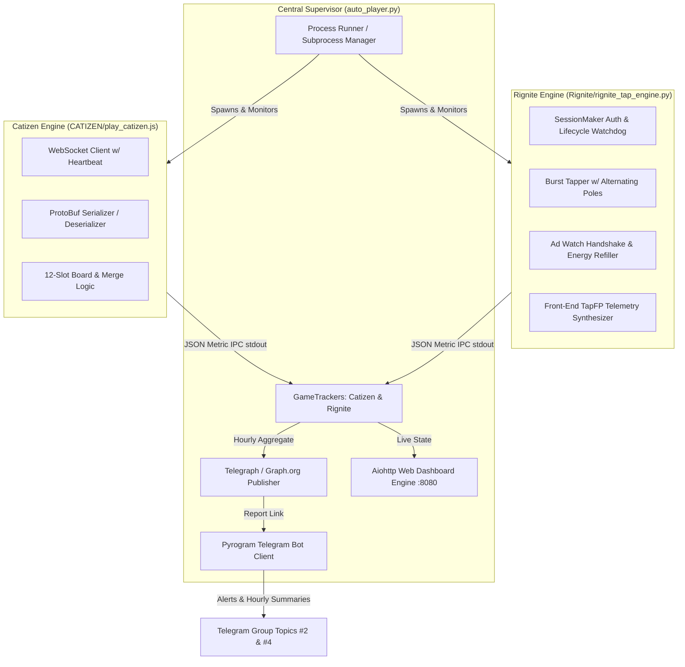

# Auto-TG Gameplay Sentinel & Supervisor ⚡🐱

An autonomous, multi-game Telegram WebApp gameplay automation framework and live command dashboard. Engineered with authentic human-like telemetry simulation, WebSocket binary protocol encoders, self-healing auth recovery, and real-time observability.

---

## 🌟 Supported Game Engines

| Game Engine | Target Bot | Protocol / Stack | Topic ID | Strategy & Execution |
| :--- | :--- | :--- | :--- | :--- |
| **Catizen Auto-Pilot** | `@catizenbot` | Node.js, WebSockets, ProtoBuf | **Topic #2** | Real-time board state manager, level-matching feline merger, auto-spawner, daily task claimer |
| **Rignite Tap Engine** | `@RigniteBot` | Python, HTTP/2 REST, JSON Telemetry | **Topic #4** | Organic Gaussian burst tapper, alternating touch poles, rewarded ad watching, smart recharge |

---

## 🏗️ System Architecture



---

## 🚀 Key Features

### 1. High-Performance Glassmorphism Web Dashboard (`http://localhost:8080`)
- **Real-Time Visual State:** Live gauges for Energy Tank, Battery Storage, Catizen 12-slot board grid, velocity counters, and rate per second/minute.
- **Interactive Process Controls:** One-click **🛑 Stop** and **▶️ Resume** toggles for individual games with baseline auto-reset for clean metric reporting after in-game expenditures.
- **Refill & Engine Action Tracker:** Live status badge showing whether Rignite is `BURST TAPPING`, `WATCHING AD REFILL`, `RECHARGING REST`, or performing `INSTANT REFILL` with second-by-second countdowns.
- **Live Terminal Log Streams:** Rolling, colored terminal output streams per engine saved simultaneously to persistent log files.
- **Direct WebApp Launcher:** Instant direct links to open the signed Telegram WebApp game instances.

### 2. Autonomous Anti-Detection & Telemetry Simulation
- **Rignite Human Tap Simulation:**
  - Jittered Gaussian intervals (`100ms - 240ms`).
  - Organic touch-pole alternation between Left and Right buttons (`~88%` alternation).
  - Front-end touch telemetry synthesis sending 32-bit signature hash (`imza`), spatial variance (`xystd`), and interval ratios (`ivcv`) to `/client-log`.
  - Realistic rewarded ad viewing (16s - 25s delays with authentic `ms` and `tapGap` values).
- **Catizen Automated Board Merge:**
  - Decodes binary WebSocket frames and tracks all 12 feline slots.
  - Automatically identifies matching pairs and emits drag-and-merge actions.
  - Auto-purchases low-cost cats when board space is open.

### 3. Telegram & Telegraph Automated Reporting
- Hourly performance snapshots compiled and published to Telegraph (`api.graph.org`).
- Structured HTML summary cards posted to dedicated Telegram chat topics (Topic #2 for Catizen, Topic #4 for Rignite).
- Engine startup and restart notifications.

---

## 🛠️ Quick Start & Setup

### Prerequisites
- **Python 3.10+**
- **Node.js 18+**

### Installation
```bash
# Clone the repository
git clone https://github.com/appujohn007/Auto-TG_Gameplay.git
cd Auto-TG_Gameplay

# Install Python dependencies
pip install -r requirements.txt

# Install Node.js dependencies for Catizen
cd CATIZEN
npm install
cd ..
```

### Environment Variables
Configure the following environment variables (or rely on defaults in `auto_player.py`):

| Variable | Description | Default |
| :--- | :--- | :--- |
| `TELEGRAM_API_ID` | Telegram API Application ID | Built-in |
| `TELEGRAM_API_HASH` | Telegram API Hash | Built-in |
| `TELEGRAM_BOT_TOKEN` | Bot token for alerts & hourly reports | Built-in |
| `WEB_PORT` / `PORT` | Web command dashboard port | `8080` |
| `PING_URL` | Self-ping keepalive URL (e.g. for Render hosting) | `""` |

### Running the Supervisor
```bash
python auto_player.py
```
Open [http://localhost:8080](http://localhost:8080) in your browser to access the live dashboard.

---

## 📂 Project Structure

```
Auto-TG_Gameplay/
├── auto_player.py              # Central Supervisor, Web Dashboard, and Telegram notifier
├── requirements.txt            # Python dependencies (aiohttp, pyrogram, requests, rich)
├── Dockerfile                  # Container deployment specification
├── AI.doc                      # Comprehensive AI Agent context and protocol guide
├── README.md                   # Project overview and setup instructions
├── CATIZEN/
│   ├── play_catizen.js         # WebSocket auto-player and merger for Catizen
│   ├── bundle_script.js        # Extracted client protocol bundle
│   ├── pb_bundle.js            # Protocol Buffers schema and encoder
│   ├── package.json            # Node.js dependencies (ws, protobufjs)
│   └── CATIZEN_PROTOCOL_GUIDE.md # Reverse-engineered protocol specification
├── Rignite/
│   ├── rignite_tap_engine.py   # Rignite human-like tap engine and telemetry emulator
│   └── chat.txt                # Session data and authentication captures
└── logs/                       # Local persistent log directory
    ├── catizen_history.log     # Catizen engine execution logs
    ├── rignite_history.log     # Rignite engine execution logs
    └── events_audit.jsonl      # Structured event logs for audits
```

---

## 🛡️ License

Private repository designed for personal game automation and research.
